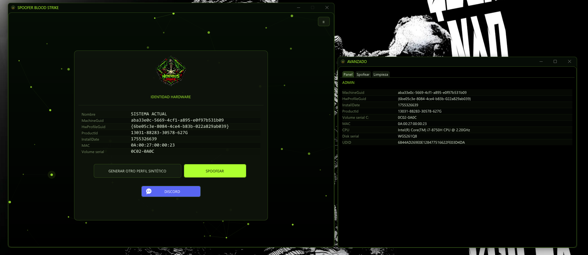

<p align="center">
  
</p>

<h1 align="center">SPOOFER BS</h1>

<p align="center">
  <b>Hardware Identity Suite para BloodStrike</b><br>
  Panel nativo en C++17 · ImGui 1.92.4 · DirectX 11 · Windows x64
</p>

<p align="center">
  
  
  
  
  <a href="https://discord.gg/CE8xPnpV6a"></a>
</p>

<p align="center">
  <a href="https://discord.gg/CE8xPnpV6a"><b>💬 discord.gg/CE8xPnpV6a</b></a> — soporte, builds y avisos
</p>

---

## ¿Qué es esto?

**SPOOFER BS** es un panel de escritorio que reescribe la identidad de hardware que BloodStrike
(NetEase · Messiah Engine) puede leer desde tu máquina, y bloquea el driver que usa para leerla.

No es un loader ni un inyector: **no toca el proceso del juego ni su memoria**. Trabaja por debajo,
sobre las fuentes del sistema operativo — registro, boot sector, adaptador de red, servicios y cachés
en disco — que son exactamente las que el motor consulta al arrancar para construir su huella.

El panel está hecho para ser **silencioso por diseño**: no escribe logs en disco, no deja caché,
no crea archivos de configuración de ImGui (`io.IniFilename = nullptr`), y borra sus propios rastros
al cerrarse. Lo único que queda en disco son los backups JSON de tu identidad original.

---

## ¿Qué hace?

Se aplican cinco capas independientes, todas activables por separado, más dos extras. La página
**SPOOFER** de la ventana AVANZADO permite desactivar cualquiera antes de ejecutar.

| Capa | Vector que neutraliza | Cómo lo hace |
|---|---|---|
| **L1** | `NEProtect.sys` — driver Ring-0 del anti-cheat | Servicio a `Start=4` (disabled) + el juego se lanza con `__COMPAT_LAYER=RUNASINVOKER`, así que corre en Medium IL: `CreateServiceW` devuelve error 5 y el driver nunca llega a cargar |
| **L2** | Cachés SQLite que sobreviven a una reinstalación | Zero-fill + borrado de `%LOCALAPPDATA%\NetEase`, `%APPDATA%\Netease\Mpay` (`336-64-mpay.db`, `clientlog.db`), `LocalLow\NetEase`, `%TEMP%\NetEase`, `%LOCALAPPDATA%\BloodStrike` (`orbit.config.cache`) |
| **L3** | GUIDs que expone `libenvsdk.dll` | Rotación en registro de `MachineGuid`, `InstallDate`, `ProductId` y `HwProfileGuid` |
| **L4** | Volume serial de `C:` | Escritura raw al boot sector NTFS (offset `0x48`, 8 bytes) — equivalente a `Volumeid.exe`, sin binarios externos |
| **L5** | MAC del adaptador de red | `NetworkAddress` en `HKLM\...\Control\Class\{4d36e972-...}` + reinicio del adaptador con `netsh` para que aplique en caliente |

**Extras:**

- **Sinkhole de telemetría** — los 5 dominios `*.easebar.com` apuntados a `0.0.0.0` en el archivo
  `hosts`, dentro de un bloque delimitado por comentarios y totalmente reversible.
- **Limpieza de rastros** — `HKCU\Software\Netease`, claves `Tracing\BloodStrike_RAS*` y entradas
  `MuiCache` del ejecutable.

**Además, el panel:**

- Muestra los 7 vectores que el juego puede leer y **cómo quedarían** antes de aplicar nada (preflight).
- Guarda un **backup automático** de tu identidad real en `profiles/backup_<UTC>.json` antes de tocar
  un solo byte, y permite **restaurarlo** desde un botón.
- Calcula el **UDID** actual — `MD5(MAC + CPU_ID + DiskSerial + MachineGuid)` en mayúsculas — que es
  el identificador compuesto que acaba usando el motor.
- **Lanza BloodStrike** solo, al terminar, ya en Medium IL.

> **Sobre SMBIOS:** el vector `GetSystemFirmwareTable('RSMB')` se muestra en el Dashboard, pero
> **no es spoofable client-side**. Se neutraliza impidiendo que `NEProtect.sys` lo lea (L1) —
> no falseando el valor.

---

## ¿Cómo funciona?

### El flujo, en orden real de ejecución

```
  [1] Captura de identidad actual  ──►  profiles/backup_<UTC>.json
                │
  [2] L1  NEProtect.sys  ──►  Start=4  (el driver ya no puede cargar)
                │
  [3] L3  Registro       ──►  MachineGuid · InstallDate · ProductId · HwProfileGuid
                │
  [4] L4  Volume serial  ──►  escritura raw al boot sector NTFS (0x48)
                │
  [5] L5  MAC            ──►  NetworkAddress + netsh disable/enable
                │
  [6] L2  Cachés         ──►  zero-fill + delete de todo lo de NetEase
                │
  [7] Extras             ──►  rastros de registro + sinkhole de hosts
                │
  [8] Lanzar juego       ──►  __COMPAT_LAYER=RUNASINVOKER  (Medium IL)
```

El orden no es casual: **primero se bloquea al que mira** (L1), y solo después se cambia lo que se
ve. Si el driver ya estuviera cargado, rotar GUIDs sería inútil porque el anti-cheat podría haber
leído los valores viejos antes. La purga de cachés va al final a propósito: borra también los
archivos que el propio spoof pudo dejar tocados.

### El hilo de trabajo

`SPOOFEAR` no bloquea la interfaz. El botón lanza un `std::thread` detached que ejecuta el pipeline;
el hilo de render sigue dibujando el fondo neuronal a 60 fps. La comunicación va por una cola de
mensajes protegida con `std::mutex`, que el hilo principal vacía una vez por frame (`drain_pending()`)
y vuelca en un ring buffer de 500 líneas — **en memoria, nunca en disco**. Mientras el worker corre,
el botón pasa a `SPOOFEANDO...` y se deshabilita junto con el resto de acciones destructivas.

### Preflight

Antes de aplicar, `spoofer::preflight()` construye una lista de filas `(etiqueta, valor actual,
valor futuro, nota)`. La UI la usa como vista previa y para avisar de condiciones que harían fallar
una capa — por ejemplo, falta de privilegios de administrador.

### Reversión

`restore()` lee el backup más reciente y reescribe los valores `orig_*` del perfil: GUIDs de registro,
`NetworkAddress` (o borra el valor si no existía), volume serial, `Start` del servicio y el bloque de
`hosts`. Es idempotente: puedes restaurar tantas veces como quieras.

### Elevación

El manifiesto pide `requireAdministrator`, así que Windows muestra el UAC antes de arrancar. Como
red de seguridad, si `identity::is_elevated()` falla, `WinMain` se relanza a sí mismo con
`ShellExecuteExW` + `runas` y el argumento `-elevated` (que evita un bucle infinito de relanzamientos).

---

## ¿Cómo está hecho?

### Stack

| Pieza | Detalle |
|---|---|
| Lenguaje | C++17, `/O2 /GS-`, subsistema `WINDOWS` (`WinMain`) |
| UI | ImGui 1.92.4 (WIP) con backends `imgui_impl_win32` + `imgui_impl_dx11` |
| Render | DirectX 11 (`D3D11CreateDeviceAndSwapChain`), fallback a `D3D_DRIVER_TYPE_WARP` si no hay GPU válida |
| Texto | `segoeui.ttf` 16 px para UI, `consola.ttf` 15 px monoespaciada para valores |
| Imágenes | WIC (`IWICImagingFactory`) decodifica el PNG embebido → textura `IMMUTABLE` → `ShaderResourceView` |
| Persistencia | `tinyjson.h`, parser/escritor JSON mínimo sin dependencias externas |
| Dependencias | Ninguna de terceros. Todo el árbol es código propio + ImGui vendorizado |

### Estructura del código

```
SPOOFER BS/
├── build.bat                  # build sin IDE (vcvars64 + rc + cl + link)
├── SPOOFER_BS.slnx            # solución VS (formato nuevo)
├── SPOOFER_BS.sln             # solución VS clásica (alternativa)
├── SPOOFER_BS.vcxproj         # toolset v145 · SDK 10.0.26100.0 · C++17
├── SPOOFER_BS.manifest        # requireAdministrator + DPI awareness
├── app.rc                     # ICON app.ico + RCDATA logo_panel.png (id 1)
├── manifest.rc                # RT_MANIFEST, solo para build.bat
├── app.ico                    # icono del exe (16–256 px)
├── logo_panel.png             # banner del README + logo embebido del panel
├── bin/SPOOFER_BS.exe         # binario final
├── panel/
│   ├── imgui/                 # ImGui 1.92.4 + backends DX11/Win32
│   └── src/
│       ├── main.cpp           # 1085 líneas — 2 ventanas, 2 contextos, render loop, tema
│       ├── spoofer.cpp        #  844 líneas — motor de 5 capas, preflight, restore, launcher
│       ├── identity.cpp       #  586 líneas — lectura de vectores, generadores, perfiles, MD5
│       ├── cleaner.cpp        #  266 líneas — escaneo y zero-fill de basura/rastros
│       ├── neuron.h           # fondo neuronal animado (BackgroundDrawList)
│       ├── tinyjson.h         # JSON sin dependencias
│       └── *.h                # interfaces de cada módulo
├── python/
│   └── spoofer_reference.py   # port de referencia del motor, auditable, CLI
├── profiles/                  # backups JSON automáticos
└── logs/                      # vacío a propósito: no se escribe nada
```

Los módulos se dividen por responsabilidad y **no se conocen entre sí** salvo por interfaces:
`identity` solo lee y genera datos, `spoofer` solo aplica cambios y recibe un `LogFn` inyectado,
`cleaner` solo borra, y `main` es el único que conoce ImGui y DirectX. Ese `LogFn`
(`std::function<void(int, const std::string&)>`) es lo que permite que el mismo motor corra en el
panel y en el port de Python sin tocar la lógica.

### Dos ventanas, dos contextos

La ventana principal y **AVANZADO** son HWND independientes, cada una con su propio swapchain y su
propio contexto ImGui (`g_ctx_main` / `g_ctx_adv`). El render loop alterna con
`ImGui::SetCurrentContext()`. No es una ventana anidada: se puede mover, minimizar y cerrar por
separado, y el panel principal sigue funcionando si la cierras.

### Detalles que importan

- **Fondo neuronal** (`neuron.h`) — partículas dibujadas con `BackgroundDrawList`, integradas por
  frame con `io.DeltaTime`. Cero texturas, cero estado global.
- **Tema** — paleta lima/negro (`#ADFF2F` sobre `#000000`), con `theme_titlebar()` aplicando
  `DwmSetWindowAttribute` para teñir la barra de título del sistema.
- **Icono** — `load_app_icon()` extrae los recursos `ICON` del propio exe en varios tamaños, así que
  la barra de tareas usa el correcto según el DPI.
- **Sin estado en disco** — `io.IniFilename = nullptr` desactiva el `imgui.ini`; el panel no recuerda
  geometría de ventanas entre ejecuciones a propósito.
- **Al salir** — `cleaner::wipe_self_traces()` borra los rastros que el propio panel pudo generar.

---

## Compilar

### Opción A — Visual Studio

Abre **`SPOOFER_BS.slnx`** y pulsa **Compilar → Generar solución** (`Ctrl+Mayús+B`).
Configuraciones: `Release|x64` y `Debug|x64`.

> Si tu VS 2022 no reconoce `.slnx`, abre **`SPOOFER_BS.sln`** (formato clásico equivalente) o activa
> *Herramientas → Opciones → Características en versión preliminar → "Usar el formato .slnx"*.

Toolset `v145`, SDK `10.0.26100.0`, C++17, subsistema Windows. Salida: `bin\SPOOFER_BS.exe`.

### Opción B — script, sin IDE

```bat
build.bat
```

Requiere Visual Studio con toolset x64 (probado con VS 2026 Community 18). Salida idéntica:
`bin\SPOOFER_BS.exe`, intermedios en `obj\`.

**Notas del build:**

- El bat fija a mano las rutas del Windows SDK (`10.0.26100.0`) porque en algunos entornos `reg.exe`
  está bloqueado dentro de `vcvarsall.bat` y la autodetección del SDK falla.
- El manifiesto se compila con `rc.exe` (`manifest.rc` → `obj\manifest.res`) y se enlaza con
  `/MANIFEST:NO`. **En Visual Studio no se usa ese `.rc`**: el proyecto genera el manifiesto con
  `<UACExecutionLevel>RequireAdministrator</UACExecutionLevel>`. Mezclar ambos produce
  `recurso duplicado MANIFEST 1` y un fallo de CVTRES.
- `app.rc` (compartido por las dos vías) embebe el icono y el PNG del panel como `RCDATA`; se
  decodifica en runtime con WIC y se sube como textura DX11.
- `identity.cpp` incluye `winsock2.h` **antes** de `iphlpapi.h`: los SDK nuevos ocultan
  `GetAdaptersAddresses` tras `#ifdef _WINSOCK2API_`.
- El SDK 26100 renombró `DXGI_USAGE_RENDER_TARGET_VIEW` → `DXGI_USAGE_RENDER_TARGET_OUTPUT`;
  `main.cpp` lleva un shim de compatibilidad.

---

## Uso

La interfaz es mínima: la tarjeta central con los 7 vectores, **GENERAR OTRO PERFIL SINTÉTICO**,
**SPOOFEAR** y **DISCORD**, sobre el fondo neuronal. Sin log en pantalla: el estado se reduce a una
línea que **solo aparece al spofear** o si el panel detecta un problema.

1. **El exe se eleva solo** — manifiesto `requireAdministrator`; si por lo que sea no lo está, se
   relanza con `runas`.
2. **GENERAR OTRO PERFIL SINTÉTICO** — rota los valores mostrados en la tarjeta sin tocar el sistema
   y cambia el nombre del perfil por uno aleatorio distinto en cada pulsación
   (`prefijo` + `sufijo` + 2 dígitos, ej. `kavex42`).
3. **SPOOFEAR** — aplica las 5 capas (si no hay perfil objetivo, genera uno al vuelo) y al terminar
   **lanza BloodStrike en Medium IL** con `__COMPAT_LAYER=RUNASINVOKER`.
   - Autodetección de ruta: `Engine\Binaries\Win64\BloodStrike.exe` dentro de `bloodstrike` en
     cualquier disco fijo, `SteamLibrary\steamapps\common\BLOODSTRIKE`, `Program Files`…; si solo
     hay `launcher.exe`, usa ese. Último recurso: barrido acotado (profundidad 4, 4000 carpetas por
     disco) buscando una carpeta con "bloodstrike" en el nombre.
   - Si `BloodStrike.exe` ya está vivo, no se relanza.
   - Desactivable en AVANZADO → *Lanzar juego (RUNASINVOKER)*.
4. **≡** (arriba a la derecha) — abre la ventana flotante **AVANZADO**, con tres pestañas:
   **Panel** (los 9 vectores leídos, incluidos CPU, Disk serial y UDID), **Spofear** (checkboxes por
   capa + restaurar último backup) y **Limpieza** (basura del sistema, del panel y del juego, con
   escaneo previo y confirmación modal).
5. **DISCORD** — abre el servidor en el navegador por defecto vía `ShellExecuteW "open"`. El icono
   de burbuja se dibuja con `ImDrawList`, sin assets extra.

La **consola vive solo en memoria** dentro de AVANZADO. Los únicos archivos en disco son los backups
JSON automáticos.

---

## Discord

<p align="center">
  <a href="https://discord.gg/CE8xPnpV6a">
    
  </a>
</p>

**https://discord.gg/CE8xPnpV6a**

Ahí van los builds nuevos, los cambios del motor que rompen o arreglan capas, y el soporte cuando algo
no aplica como debería. Si el panel falla, el mensaje exacto de la línea de estado es lo más útil que
puedes pegar.

---

## Limitaciones conocidas

- **Baneo de cuenta:** imposible client-side — vive en el backend de NetEase. Esto cubre el HWID ban,
  no una sanción de cuenta.
- Volume serial y `hosts` requieren `C:` desocupado y privilegios de administrador.
- Algunos adaptadores aplican la MAC solo al reiniciar Windows (el panel lo indica en la línea de
  estado).
- Tras cambiar los GUIDs de registro, `slui` / la activación de Windows puede pedir reactivación.
- SMBIOS no se falsea (ver nota arriba): se bloquea el lector.

---

## Aviso

Herramienta de investigación sobre fingerprinting y anti-cheat en Windows. Úsala solo en máquinas y
cuentas propias. El autor no se hace responsable del uso que se le dé.

---

## Créditos

Evidencia: `decomp/16_spoofer/*` (feasibility, fingerprint, registry_keys, driver_blocking) y
`decomp/07_system_footprint/evidence/*`. Backend ImGui reutilizado de `T2M - FREE SOURCE/junior/`.
